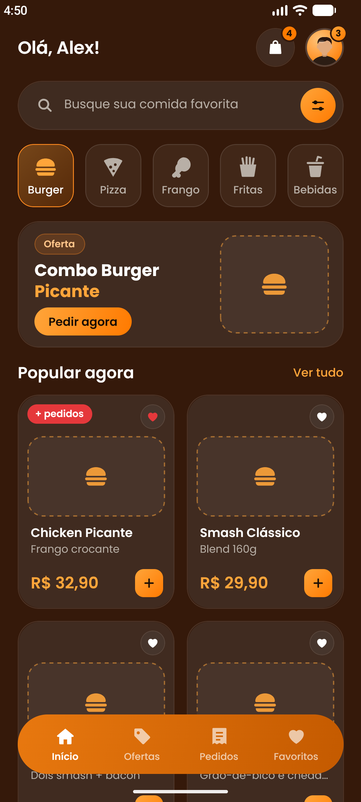
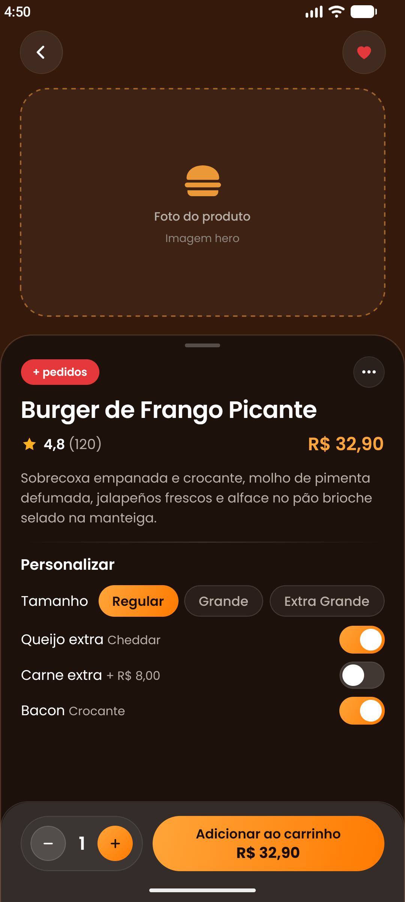
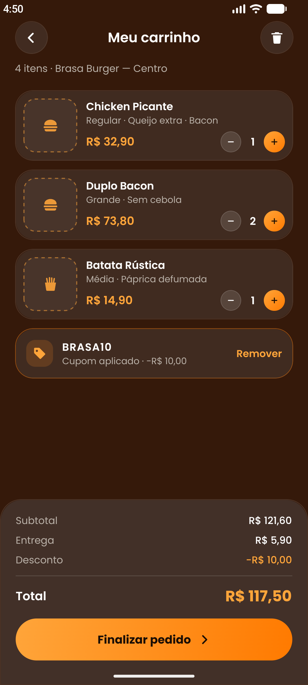
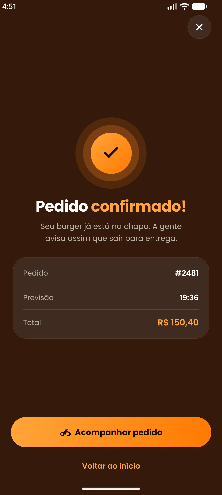
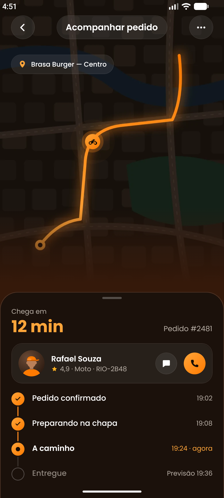
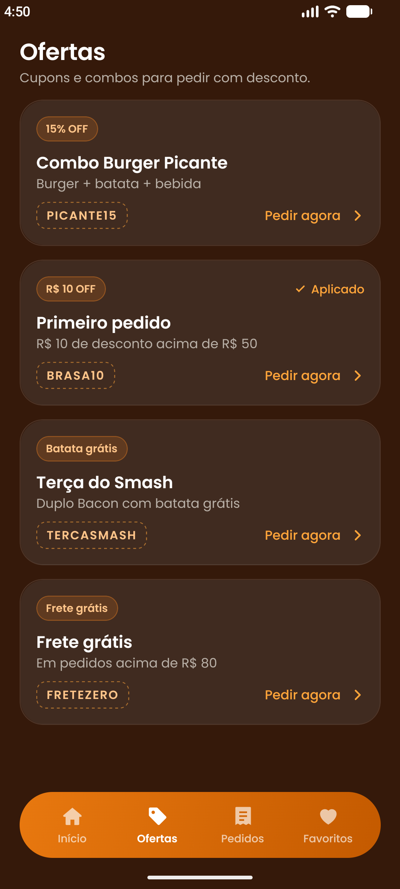
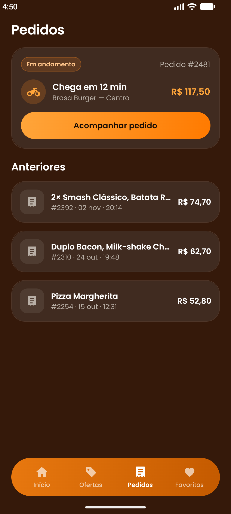
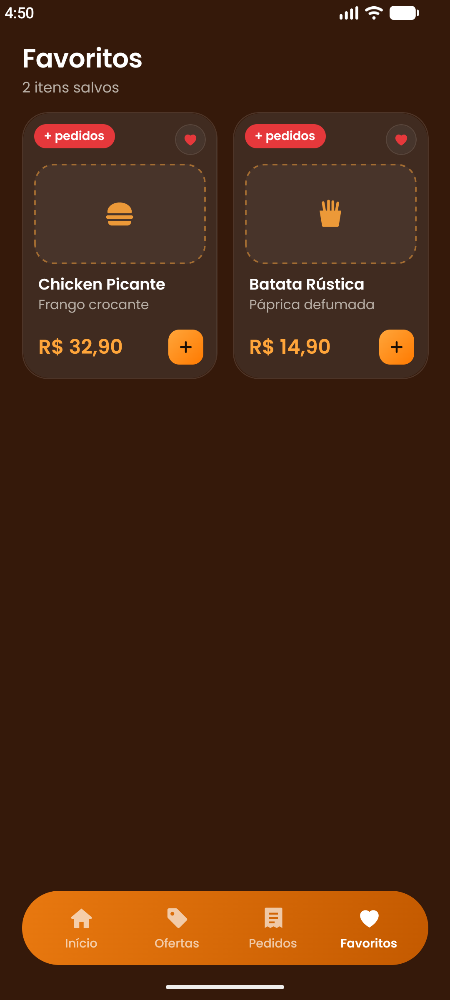

# 🔥 Brasa — app de delivery de hamburgueria

App mobile de delivery com visual **dark warm + glassmorphism + acento laranja**, desenvolvido com **React Native + Expo + TypeScript**. Projeto de portfólio: o layout UX/UI foi prototipado em HTML e implementado aqui de ponta a ponta.

> **Sem API.** Cardápio, ofertas, pedidos e rastreamento são **dados hard coded** em [`src/data/menu.ts`](src/data/menu.ts). O carrinho, o cupom e os favoritos funcionam de verdade, em estado local.

## Telas

<table>
  <tr>
    <td align="center"><br /><sub><b>Início</b></sub></td>
    <td align="center"><br /><sub><b>Detalhe do produto</b></sub></td>
    <td align="center"><br /><sub><b>Carrinho</b></sub></td>
    <td align="center"><br /><sub><b>Pedido confirmado</b></sub></td>
  </tr>
  <tr>
    <td align="center"><br /><sub><b>Rastreamento</b></sub></td>
    <td align="center"><br /><sub><b>Ofertas</b></sub></td>
    <td align="center"><br /><sub><b>Pedidos</b></sub></td>
    <td align="center"><br /><sub><b>Favoritos</b></sub></td>
  </tr>
</table>

## Funcionalidades

- Busca e filtro por categoria (Burger, Pizza, Frango, Fritas, Bebidas)
- Detalhe do produto com tamanho, extras e quantidade, com total recalculado na hora
- Carrinho com stepper, remoção ao zerar a quantidade, cupom `BRASA10` e resumo (subtotal, entrega, desconto, total)
- Favoritos persistidos durante a sessão
- Fluxo completo: produto → carrinho → pedido confirmado → rastreamento
- Navegação por abas com tab bar flutuante customizada
- Animações de entrada, feedback de toque (escala + haptics) e pulso do entregador no mapa

## Stack

| Camada | Tecnologia |
| --- | --- |
| Framework | React Native + **Expo SDK 58** |
| Linguagem | **TypeScript** (strict) |
| Navegação | **Expo Router** (file-based): Stack + Tabs |
| Estado | **Zustand** |
| Animações | **Reanimated 4** |
| UI | `expo-blur`, `expo-linear-gradient`, `react-native-svg` (ícones próprios) |
| Tipografia | **Poppins** (`@expo-google-fonts/poppins`) |
| Extras | `expo-haptics`, `expo-image` |

## Como rodar

Pré-requisitos: Node 20+ e o app **Expo Go** no celular (ou um emulador Android/iOS).

```bash
git clone https://github.com/gabrielmarcato/brasa-app.git
cd brasa-app
npm install
npx expo start
```

Escaneie o QR code com o Expo Go, ou pressione `a` (Android), `i` (iOS) ou `w` (web).

Qualidade de código:

```bash
npm run typecheck
npx eslint src
```

## Estrutura

```
src/
  app/            rotas (Expo Router)
    (tabs)/       Início, Ofertas, Pedidos, Favoritos
    produto/[id]  detalhe do produto
    carrinho, confirmado, rastreamento
  components/     Icon, ui (Glass, GradientButton, Txt…), ProductCard, TabBar
  data/menu.ts    dados mockados
  store/cart.ts   carrinho, cupom e favoritos (Zustand)
  theme/          tokens de cor, tipografia e raios
assets/images/    avatar, entregador e mapa
screenshots/      capturas usadas neste README
```

## Decisões de design

- **Tokens centralizados** em `src/theme`: cor de fundo, laranja de acento, raios e fontes em um só lugar.
- **Glass sem sombras:** o efeito de vidro vem de blur, uma camada translúcida e uma borda fina.
- **Placeholders de foto:** as imagens dos produtos são placeholders; para usar fotos reais, troque `PhotoPlaceholder` por `<Image>` nos cards, no detalhe e no carrinho.
- No Android, o blur usa `dimezisBlurView` (modo experimental do `expo-blur`).

---

Feito por [Gabriel Marcato](https://github.com/gabrielmarcato).
